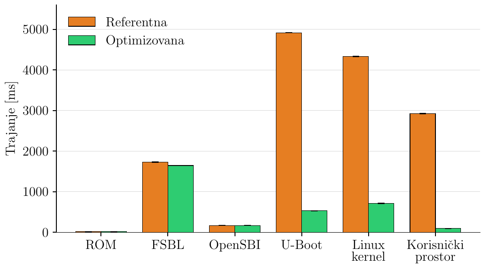
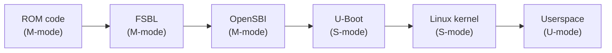
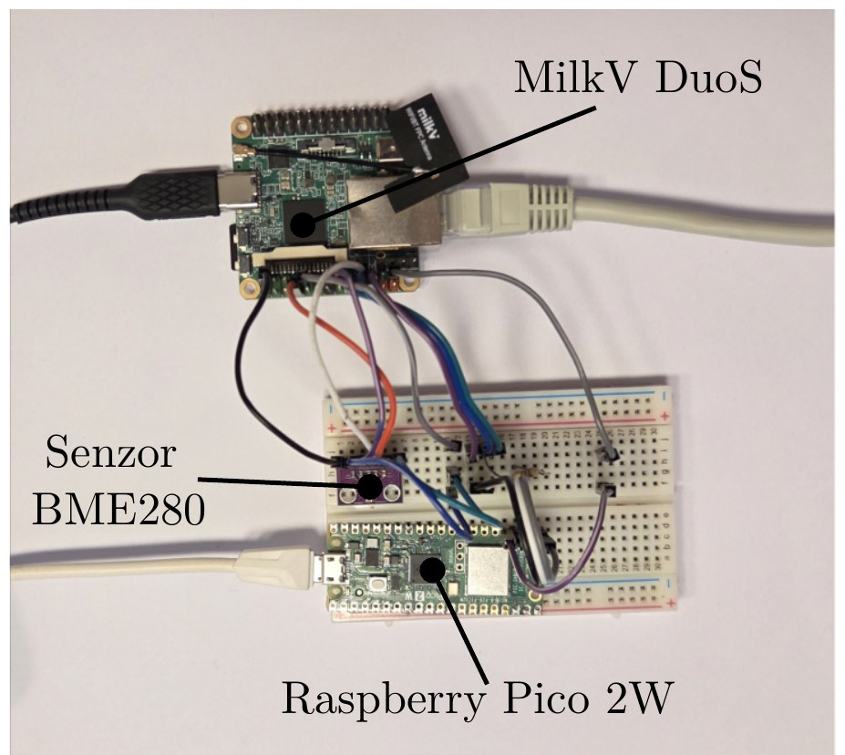
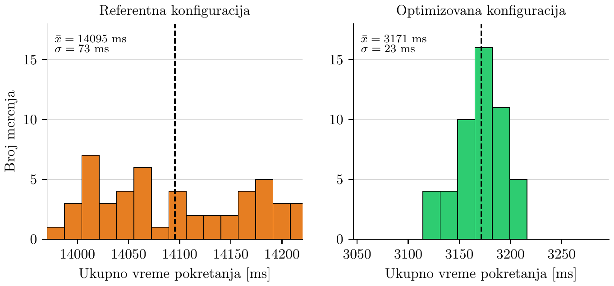

# Linux Boot Time Optimization on RISC-V (Milk-V Duo S)

Analysis and optimization of cold-boot time of an embedded Linux system on the **Milk-V Duo S** board (**Sophgo SG2000** SoC, RISC-V core), starting from the vendor BSP (`duo-buildroot-sdk-v2`).

This is my Bachelor's thesis at the School of Electrical Engineering, University of Belgrade (mentor: Dr Vladimir Rajović). The full thesis (in Serbian) is in [`docs/thesis.pdf`](docs/thesis.pdf).

| | Vendor BSP | Optimized | Reduction |
|---|---:|---:|---:|
| **Total boot time** (power-on → first sensor reading sent over the network) | 14.10 s | **3.17 s** | 77.5 % (4.4×) |
| **Stages under my control** (U-Boot + kernel + userspace) | 12.18 s | **1.34 s** | 89.0 % (9.1×) |

Every change is a **configuration, device tree or ordering change**. No application code was modified, no hardware was changed, and no functionality was removed.



*Mean duration of each boot phase, 50 runs per configuration. Orange: vendor BSP ("Referentna"), green: optimized ("Optimizovana"). Figure from the thesis, labels in Serbian ("Korisnički prostor" = userspace).*

---

## Contents

- [Goal and definition of boot time](#goal-and-definition-of-boot-time)
- [Hardware and software](#hardware-and-software)
- [Measurement method](#measurement-method)
- [Optimizations](#optimizations)
  - [ROM, FSBL and OpenSBI (not modified)](#rom-fsbl-and-opensbi-not-modified)
  - [U-Boot](#u-boot)
  - [Linux kernel](#linux-kernel)
  - [Userspace](#userspace)
- [Results](#results)
- [Future work](#future-work)
- [Patches](#patches)
- [Manual changes on the target](#manual-changes-on-the-target)
- [Reproducing](#reproducing)
- [Repository layout](#repository-layout)
- [References](#references)

---

## Goal and definition of boot time

Vendor configurations are tuned for an easy start in development, not for fast boot: every on-board peripheral is enabled, debug tooling is included, and defaults match the vendor's intended use case (here, primarily cameras). The goal of this project was to measure where boot time goes on this platform and reduce it stage by stage.

**Start point:** the moment power is applied (cold boot).

**End point:** the target application has read the temperature from a **BME280** sensor over **I2C** and sent it to a host PC in a **UDP** datagram. This end point was chosen deliberately: it proves that both a slow external bus and the network stack are fully up, not just that a process has started.

The measured interval is split into six phases matching the RISC-V boot flow:



**Constraints:** software changes only, application code unchanged, so every difference in measured time comes from system configuration. Power consumption, image size and runtime performance were not optimization targets.

---

## Hardware and software

**Board:** Milk-V Duo S, Sophgo SG2000 (RISC-V core selected via the on-board switch), 512 MB DRAM, booting from a V10 microSD card (measured read speed 40 MB/s), 100 Mbit/s Ethernet.

**Sensor:** Bosch BME280 on I2C1, address `0x76`.

| BME280 pin | Signal | Duo S pin | Purpose |
|---|---|---|---|
| 1 | VCC | 17 | 3V3 supply |
| 2 | GND | 20 | Ground |
| 3 | SCL | 7 | I2C clock |
| 4 | SDA | 11 | I2C data |
| 5 | CSB | 17 | Tied high: selects I2C instead of SPI |
| 6 | SDO | 25 | Tied to GND: address `0x76` |

**Software versions:**

| Component | Version |
|---|---|
| SDK | `duo-buildroot-sdk-v2` |
| Buildroot | 2025.02 |
| U-Boot | 2021.10 |
| OpenSBI | v0.9 |
| Linux kernel | 5.10.4 |
| C library | musl |
| Cross-compiler | `riscv64-unknown-linux-musl-gcc` |

Built on Ubuntu 24.04. Root filesystem changes are applied through `BR2_ROOTFS_OVERLAY` so they survive every rebuild.

**Target application** ([`app/`](app/)): a small C program that reads `in_temp_input` from the kernel's IIO driver in sysfs, sends `temp=<value>` to `192.168.10.1:5005` over UDP, and prints `Temperature sent` on the serial console to mark the end of the measurement.

---

## Measurement method

The kernel's own timestamps start at kernel entry, so they miss ROM, FSBL, OpenSBI and U-Boot entirely. Measurement is therefore done externally, from the serial console.



*Milk-V Duo S (top), BME280 sensor and Raspberry Pi Pico 2 W on the breadboard (bottom).*

**Measurement chain:**

```
Milk-V Duo S ──UART──► Raspberry Pi Pico 2 W ──USB──► Host PC (grabserial + bash)
     3V3 rail ──GPIO18──┘
```

- **Raspberry Pi Pico 2 W as a UART-to-USB bridge** ([`measurement/pico/`](measurement/pico/), MicroPython). A plain USB-serial adapter can't see the moment power is applied, so it would miss the first phase. The Pico watches the board's 3V3 rail on GPIO18 with an interrupt on both edges:
  - **Rising edge:** store the power-on timestamp.
  - **First UART byte:** store its timestamp from the same microsecond counter; the difference is the ROM phase duration.
  - **Falling edge:** reset all state, so the next power cycle needs no manual action.
  - The bridge is bidirectional, so the U-Boot console stays usable during development.

  | Duo S pin | Signal | Pico pin |
  |---|---|---|
  | 8 | TX | GP17 (RX) |
  | 10 | RX | GP16 (TX) |
  | 6 | GND | GND |
  | 1 | 3V3 | GP18 (power detection) |

- **Host logging:** `grabserial` timestamps every received line:
  ```sh
  grabserial -d /dev/ttyACM0 -b 115200 -t -e 20 -o boot_full.log
  ```
- **Automatic phase extraction** ([`measurement/parse_boot.sh`](measurement/parse_boot.sh)): a bash script reads `boot_full.log` from the current directory, finds the phase boundary messages, computes each phase as the difference between consecutive timestamps and appends the result to `all_measurments.log`:

  | Phase | Boundary message |
  |---|---|
  | ROM | `ROM phase` (printed by the Pico) |
  | FSBL | `SCS/` |
  | OpenSBI | `OpenSBI v0.9` |
  | U-Boot | `U-Boot 2021.10` |
  | Kernel | `Starting kernel ...` |
  | Userspace | `Run /sbin/init` |
  | End | `Temperature sent` |

- **Statistics:** the reference and final configurations were each measured **50 times** from a fully powered-off state; results are reported as mean ± standard error. Intermediate configurations, used to estimate the contribution of individual changes, were measured fewer times.

**Known measurement bias:** a timestamp marks when a message is *printed*, not when the preceding work finished. Printing also costs time: at 115200 baud, one line takes about **6 ms**. The reference configuration prints hundreds of lines and the optimized one is quiet, so part of the measured difference comes from console output itself. This is documented rather than hidden, and the console cost turned out to be a real optimization target (see [Linux kernel](#linux-kernel)).

---

## Optimizations

The same loop was applied in every stage: **measure where time goes → find the cause → change one thing → rebuild → re-measure and verify**. Changes that didn't help or broke the system were reverted. Stages were optimized in boot order, because each stage prepares the environment for the next one.

### ROM, FSBL and OpenSBI (not modified)

- **ROM** (~17 ms) is mask ROM inside the chip and cannot be changed.
- **FSBL** (~1.65 s) is a vendor-specific first-stage loader (not U-Boot SPL) with no separate documentation; changes would mean modifying DRAM initialization, clock setup and the memory map, which is beyond configuration-level work.
- **OpenSBI** (~169 ms) is open and documented, but its work (trap handlers, transition to S-mode) is mostly mandatory.

### U-Boot

**4918 ms → 533 ms (−89.2 %)**

Gaps between consecutive U-Boot messages showed that three items dominated the stage:

| Item | Duration | Share of stage |
|---|---:|---:|
| SD card tuning | 2301.5 ms | 46.8 % |
| Kernel image decompression (LZMA) | 1178 ms | 24.0 % |
| `bootdelay` | 1000 ms | 20.3 % |
| Everything else | 438.5 ms | 8.9 % |

**1. SD card tuning (−2.3 s).** The card ran in UHS **SDR104** at 208 MHz. At that speed the data-valid window is tiny, so the controller sweeps sampling phases to find a working one. Reading the driver source showed that each of **128 phases is tested up to 51 times**, which is up to **6528 bus commands**. Two fixes were considered:
- Fewer retries per phase: keeps full throughput, but risks accepting a marginal phase that fails under different conditions.
- **A slower mode where tuning isn't needed (chosen):** tuning cost more than 2 s, and all it bought was slightly faster reading of a ~3 MB file.

Implemented by masking the controller's capability bits in the device tree with `sdhci-caps-mask`, so the high-speed modes are never entered.

**2. Kernel image compression (−1.17 s).** Benchmarked all available options (5 runs each, timing reported by U-Boot itself):

| Compression | Decompression time |
|---|---:|
| LZMA (vendor default) | 1178 ms |
| GZIP | 199 ms |
| LZ4 | 220 ms |
| **None** | **5 ms** |

LZMA was the worst option on this hardware by almost a full second. Switched to an **uncompressed image**: it grows from ~3 MB to ~7 MB and takes longer to read from the card, but removing decompression saves far more. The remaining 5 ms is the copy of 7.7 MiB from the load address to the execution address. LZMA and LZ4 support were then removed from U-Boot.

**3. Removed unused components:** display support and BMP image support, the vendor video-output command, and random MAC address generation (networking is not used in U-Boot). The U-Boot binary shrank from 528,303 to 459,679 bytes (−13 %).

**4. `bootdelay=0` (−1.0 s).** Applied last, because the U-Boot console was needed while testing the other changes.

**5. I2C pin muxing for the sensor.** This doesn't save time, but it is required: the sensor pins default to GPIO, so they must be switched to I2C **before** the kernel probes devices, which means in U-Boot.

### Linux kernel

**4336 ms → 710 ms (−83.6 %)**

**Finding the real cost.** `initcall_debug` was tried first, but the sum of all initcalls was only a few hundred milliseconds. Worse, with full console output it printed 898 lines during the kernel stage, about 5.4 s of serial output, so the measurement was dominated by its own logging. Analysis switched to the same timestamp-gap method used for U-Boot.

**1. Console log level (−1.44 s).** The vendor passes `loglevel=9`, which equals 8 (everything), so hundreds of lines go to the serial port at ~6 ms each. Setting `loglevel=0` (in the boot arguments U-Boot passes to the kernel, `include/configs/cv181x-asic.h`) leaves only emergency messages on the console. Messages still go to the ring buffer, whose size was increased (the vendor's `CONFIG_LOG_BUF_SHIFT=15` override was dropped in favor of the larger default) so the whole boot log can be read later with `dmesg` at no serial cost. Applied last, because kernel messages were needed while working on the other changes.

**2. SD card tuning, again (−2.3 s).** With a quiet console, the kernel stage broke down like this (single run, after the U-Boot changes):

| Item | Duration | Share of stage |
|---|---:|---:|
| Initialization | 287.70 ms | 10 % |
| Waiting for SD card | 2297 ms | 80 % |
| Root filesystem mount | 287.97 ms | 10 % |

This was the **same tuning procedure** already removed from U-Boot, but now running in the kernel. **Root cause:** in the slower SDR50 mode tuning is optional, but the controller still advertises that it wants it. U-Boot ignores that capability bit and skips tuning; the kernel reads it and tunes anyway. The fix was to extend the mask to clear that bit too:

```dts
sdhci-caps-mask = <0x2006 0x0>;
```

- `0x0002`, `0x0004`: remove SDR104 and DDR50 support (from the U-Boot change)
- `0x2000`: remove the "use tuning for SDR50" request (added for the kernel)

Since U-Boot and the kernel share the same device tree, one property fixes both stages, and the extra bit has no effect on U-Boot because U-Boot doesn't read it.

**3. Removed unused drivers:** Bluetooth, Wi-Fi and its driver, audio, USB cameras, SPI NOR flash (not present on the board) and suspend support. This doesn't remove any waiting on hardware, but it shrinks the kernel image, which shortens reading it from the card. At the same time, `CONFIG_IIO` and `CONFIG_BMP280` were enabled for the sensor, and a `bosch,bme280` node was added under `&i2c1` in the device tree.

### Userspace

**2925 ms → 94.5 ms (−96.8 %, the largest relative reduction)**

Userspace scripts run silently, so the init script loop was first extended to print each script's name, which gives every script a timestamp in the log.

**Selection criterion:** the application needs exactly four things: I2C pin function set, sensor driver bound, IP address assigned, Ethernet link up. Anything else that runs before it is pure delay.

| Change | Saved |
|---|---:|
| Ethernet link setup | 1020 ms |
| Removing unused init scripts | 680 ms |
| Removing multimedia drivers | 670 ms |
| Shortening the init chain | 260 ms |
| Other | 200 ms |

**1. Ethernet link (1.05 s → ~30 ms).** Bringing the interface up is nearly instant; the cost was **auto-negotiation**, during which the CPU simply waits. Two changes:
- Interface bring-up and address assignment moved to the top of `/etc/inittab`, so they start as early as possible and overlap with the rest of boot.
- Speed and duplex fixed on both ends of the link, so no negotiation is needed:
  ```sh
  ethtool -s eth0 speed 100 duplex full autoneg off
  ```

**2. Removed unused init scripts (−680 ms).** These changes were made directly on the target's root filesystem, see [Manual changes on the target](#manual-changes-on-the-target):
- Network services: DHCP client (the most expensive script; addresses are static here) and interface configuration (only loopback was configured).
- Daemons: syslog (the kernel ring buffer covers this), cron, and remote shell access.
- Bluetooth support.

Emptying a script doesn't remove its cost, because launching it still forks a process, so scripts were renamed so the init mechanism no longer picks them up.

**3. Removed the multimedia subsystem (−670 ms).** The vendor `loadsystemko.sh` loaded **18 kernel modules** for camera capture, video processing, display and encoding, each one a new process plus a file read from the card. None are used here. Only the thermal management module was kept: it throttles the CPU clock on overheating, which is hardware protection, and its boot cost is negligible.

**4. Shortened the init chain (−260 ms).** After removing the scripts, the rc mechanism existed only to start one program, so the application is launched directly from `inittab` ([`rootfs/etc/inittab`](rootfs/etc/inittab)), removing two intermediate processes.

---

## Results

Mean of 50 runs per configuration (± standard error, σ = standard deviation):

| Phase | Reference [ms] | σ | Optimized [ms] | σ |
|---|---:|---:|---:|---:|
| ROM | 17.53 ± 0.09 | 0.66 | 17.69 ± 0.19 | 1.31 |
| FSBL | 1730 ± 10 | 74 | 1647.2 ± 0.7 | 5.0 |
| OpenSBI | 168.7 ± 0.3 | 1.8 | 168.7 ± 0.3 | 2.1 |
| U-Boot | 4917.9 ± 1.5 | 10.9 | **533.0 ± 0.7** | 5.1 |
| Linux kernel | 4336 ± 5 | 32 | **710.1 ± 3.3** | 23.1 |
| Userspace | 2924.6 ± 3.3 | 23.4 | **94.5 ± 0.3** | 2.4 |
| **Total** | **14095 ± 10** | 73 | **3171.3 ± 3.2** | 22.9 |

| Phase | Saved [ms] | Reduction | Share of total savings |
|---|---:|---:|---:|
| U-Boot | 4384.9 ± 1.7 | 89.2 % | 40.1 % |
| Linux kernel | 3626 ± 6 | 83.6 % | 33.2 % |
| Userspace | 2830.1 ± 3.3 | 96.8 % | 25.9 % |
| FSBL | 83 ± 10 | 4.8 % | 0.8 % |
| **Total** | **10924 ± 11** | **77.5 %** | 100 % |



*Distribution of total boot time over 50 runs: vendor BSP (left) and optimized (right); dashed line = mean. Figure from the thesis, labels in Serbian.*

**Observations:**
- **Boot also became more predictable.** The standard deviation of total boot time dropped from 73 ms to 23 ms.
- **The FSBL "saving" is not an optimization result.** FSBL was not modified. In the reference series, 27 runs clustered tightly around 1670 ms while the rest scattered between 1704 and 1869 ms, raising the mean; this effect did not appear in the optimized series. The cause is still unknown and is a possible direction for further work.
- **The bottleneck has moved.** Stages that can't be changed by configuration made up 13.6 % of boot time before and **57.8 %** after, with FSBL alone at 51.9 %, more than all other stages combined. Configuration-level optimization has reached its limit on this platform.

**Main takeaway:** the vendor defaults weren't bad; they were tuned for a different use case. SD tuning for maximum speed makes sense for a device that constantly accesses the card, LZMA makes sense when storage is small and expensive, and loading multimedia drivers makes sense for a camera. None of that holds for a device that boots once, reads a sensor and sends a packet. Most of the work was finding which inherited assumptions still applied. In several cases **overlapping work beat removing it**: link negotiation wasn't eliminated, it was moved earlier so it runs alongside work that happens anyway.

---

## Future work

- **Further kernel config reduction.** After correcting for console cost, real driver initialization is ~241 ms, mostly for required drivers. The remaining gain is in removing code that never runs, which shrinks the image and its read time.
- **Read-only root filesystem without a journal.** The root fs is ext4, and journal recovery runs on every boot (~287 ms mount). The root fs never changes at runtime, so the journal protects nothing. **SquashFS** would remove this step and reduce bytes read from the card. `SQUASHFS`, `SQUASHFS_LZ4` and `TMPFS` are already enabled in preparation.
- **Application as the first process.** Pointing `init=` at a script that does the minimal setup, starts the application and then `exec`s the real init would give the lower bound for userspace and show how much of the remaining 94.5 ms is system initialization versus the application's own work.

---

## Patches

All changes to the vendor SDK are in [`patches/`](patches/), generated with `git diff` against `duo-buildroot-sdk-v2`:

| Patch | Contents |
|---|---|
| [`01-u-boot.patch`](patches/01-u-boot.patch) | U-Boot defconfig (`bootdelay=0`; display, BMP, LZMA/LZ4, vendor video command and random MAC removed), I2C1 pin muxing for the BME280 in `board.c`, kernel `loglevel=0` in the boot arguments |
| [`02-kernel-config.patch`](patches/02-kernel-config.patch) | Kernel defconfig: Bluetooth, Wi-Fi, SPI NOR, USB video, sound and suspend removed; `IIO` + `BMP280` enabled; larger log buffer |
| [`03-device-tree.patch`](patches/03-device-tree.patch) | BME280 node on `i2c1`; SDR104 disabled and `sdhci-caps-mask = <0x2006 0x0>` on the SD controller |
| [`04-build-and-rootfs.patch`](patches/04-build-and-rootfs.patch) | Uncompressed kernel image (`CONFIG_KERNEL_UNCOMPRESSED`), Wi-Fi modules no longer loaded in `duo-init.sh`, BusyBox config (incl. `bootchartd` used during analysis), `pqtool_server` build disabled |

---

## Manual changes on the target

The userspace optimizations were applied directly on the root filesystem of the SD card rather than through the Buildroot overlay, so they are not part of the patches:

- Unused init scripts in `/etc/init.d/` were renamed so `rcS` no longer picks them up: DHCP client, network interface configuration, syslog, cron, remote shell access and Bluetooth.
- `/mnt/system/ko/loadsystemko.sh` was trimmed so the 18 multimedia kernel modules are no longer loaded; only the thermal management module is kept.
- `/etc/inittab` was replaced with [`rootfs/etc/inittab`](rootfs/etc/inittab).

---

## Reproducing

1. Clone the vendor SDK and apply the patches:
   ```sh
   git clone https://github.com/milkv-duo/duo-buildroot-sdk-v2
   cd duo-buildroot-sdk-v2
   git apply /path/to/this/repo/patches/*.patch
   ```
2. Build the target application from [`app/app.c`](app/app.c) with the SDK cross-compiler (`riscv64-unknown-linux-musl-gcc`) and place it in the Buildroot overlay as `device/generic/br_overlay/musl_riscv64/usr/bin/app`.
3. Build and flash:
   ```sh
   ./build.sh milkv-duos-musl-riscv64-sd
   sudo dd if=<image>.img of=/dev/sdX bs=1M status=progress
   ```
4. Apply the [manual changes on the target](#manual-changes-on-the-target) to the root filesystem on the SD card.
5. Wire the BME280 and the Pico as shown in the tables above, copy [`measurement/pico/main.py`](measurement/pico/main.py) to the Pico, and set a static address `192.168.10.1/24` with a fixed 100 Mbit/s full-duplex link on the host interface.
6. Log a boot and extract the phase durations:
   ```sh
   grabserial -d /dev/ttyACM0 -b 115200 -t -e 20 -o boot_full.log
   ./parse_boot.sh            # reads boot_full.log, appends to all_measurments.log
   ```

---

## Repository layout

```
├── README.md
├── patches/
│   ├── 01-u-boot.patch
│   ├── 02-kernel-config.patch
│   ├── 03-device-tree.patch
│   └── 04-build-and-rootfs.patch
├── rootfs/etc/inittab          # optimized BusyBox init configuration
├── app/app.c                   # target application: BME280 via sysfs, UDP send
├── measurement/
│   ├── pico/main.py            # MicroPython UART bridge with power-on detection
│   └── parse_boot.sh           # boot log → phase durations
├── results/
│   ├── reference_50_runs.log   # vendor BSP, 50 cold boots
│   └── optimized_50_runs.log   # optimized, 50 cold boots
└── docs/
    ├── thesis.pdf              # full thesis (in Serbian)
    └── img/                    # figures and setup photo
```

---

## References

- Bootlin, *Embedded Linux Boot Time Optimization* training materials: https://bootlin.com/doc/training/boot-time/boot-time-slides.pdf
- A. Murray, *The Right Approach to Minimal Boot Times*, Embedded Linux Conference 2010: https://elinux.org/images/f/f7/RightApproachMinimalBootTimes.pdf
- A. Patra, *RISC-V Boot Flow: What Is Next?*, FOSDEM 2020: https://archive.fosdem.org/2020/schedule/event/riscv_bootflow/
- C. Simmonds, *Mastering Embedded Linux Programming*, Packt
- Milk-V Duo S documentation: https://milkv.io/docs/duo/getting-started/duos
- Milk-V `duo-buildroot-sdk-v2`: https://github.com/milkv-duo/duo-buildroot-sdk-v2

---

**Author:** Vojin Vukčević, [github.com/vojinvukcevic](https://github.com/vojinvukcevic)
